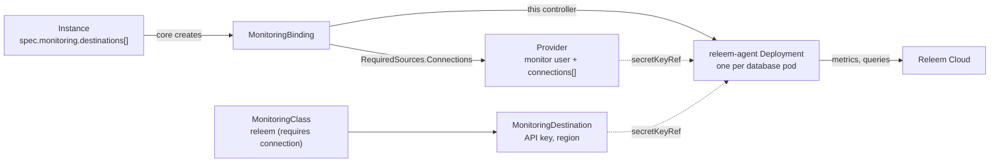

# monitoring-releem

> [!WARNING]
> **Experimental.** This repository is an experiment in running [Releem](https://releem.com)
> for OpenEverest instances. The design, chart values and defaults will change. Not for
> production use.

Send the metrics and query statistics of [OpenEverest](https://github.com/openeverest/openeverest)
MySQL, MariaDB and PostgreSQL instances to Releem, which recommends configuration and query
changes.

## What this is

A monitoring extension for OpenEverest. It installs the `releem` `MonitoringClass` and the
controller that fulfils it. The class is **ExtensionManaged** and requires **connections**:
the database provider creates a read-only monitoring user and publishes it, with one
connection endpoint per database pod, in `Instance.status.monitoring.sources`. This controller
runs one [releem-agent](https://github.com/Releem/mysqlconfigurer) per database pod, logging in
with that user.

Nothing is installed by hand in the database, and the database pods are not touched
(`disruption: None`). Releem only **recommends**: OpenEverest owns the engine configuration,
so recommendations are applied through the Instance, never by the agent.

> [!IMPORTANT]
> **This extension is not standalone.** It requires an OpenEverest installation and a provider
> whose component types declare `connection: Supported`. Today that is the CloudNativePG
> provider on its `experiment/monitor-connections` branch.

## How it fits



1. **Class.** Requires `connection: true` for the kinds `mysql`, `mariadb` and `postgresql`.
   Core computes compatibility per provider from the contract alone: a provider whose
   components are of another kind gets `KindUnsupported` (MongoDB, for example).
2. **Destination.** Holds the Releem API key in its credentials Secret (`APIKey` mode,
   key `apiKey`), the Releem region (`US` or `EU`) and an optional server name prefix.
3. **Provider.** While a bound class requires connections, the provider makes sure the
   monitoring user exists (CloudNativePG creates `openeverest_monitor`, a member of
   `pg_monitor` and `pg_read_all_data`) and publishes its Instance-owned Secret under the
   `monitor` credential profile, with a connection endpoint (pod selector, container, port,
   TLS). When the last such binding goes, it drops the user and deletes the Secret.
4. **Agents.** For every accepted binding, the controller applies one Deployment per running
   database pod, named `<binding>-<pod>` and owned by the binding. The agent connects to the
   pod's address directly, so Releem sees every server of the Instance. The API key and the
   database login reach it as `secretKeyRef` environment variables: the controller never reads
   a Secret. Agents follow pods: a new address re-renders the agent, a pod that is gone loses
   its agent, and removing the Instance entry garbage-collects them all. On PostgreSQL a
   liveness probe logs in with the agent's own environment every minute: after a password
   rotation it fails, and the restarted container reads the new password from the Secret.
5. **Status.** The binding is `Configured` once every agent runs, `AgentNotReady` while one
   does not, and `EndpointNotServing` while the Instance publishes no connections.

| Destination parameter | Default | Purpose |
|---|---|---|
| `region` | `US` | Releem data region: `US` or `EU` |
| `hostnamePrefix` | none | Put before every server name (`<prefix><pod>.<namespace>`) |

| Instance entry parameter | Default | Purpose |
|---|---|---|
| `queryOptimization` | `false` | Collect query samples and EXPLAIN plans |

```yaml
apiVersion: v1
kind: Secret
metadata: {name: releem-key, namespace: team-a}
stringData: {apiKey: <Releem API key>}
---
apiVersion: monitoring.openeverest.io/v1alpha1
kind: MonitoringDestination
metadata: {name: releem, namespace: team-a}
spec:
  classRef: {name: releem}
  authentication: {mode: APIKey, credentialsSecretRef: {name: releem-key}}
  parameters: {region: EU, hostnamePrefix: prod-}
---
# On the Instance
spec:
  monitoring:
    destinations:
      - {name: releem, destinationRef: {name: releem}, parameters: {queryOptimization: true}}
```

## Installation

```bash
helm install monitoring-releem charts/monitoring-releem -n everest-system \
  --set image.repository=<image> --set image.tag=<tag>
kubectl get monitoringclass releem
```

| Chart value | Default | Purpose |
|---|---|---|
| `class.create` | `true` | Install the `MonitoringClass` |
| `class.name` | `releem` | Name of the class |
| `class.controllerName` | `openeverest.io/monitoring-releem` | Controller name the class is claimed by |
| `agent.image` | `releem/releem-agent:1.26.2` | Agent image |

The controller caches only pods labelled `core.openeverest.io/instance` and the Deployments it
manages, and its RBAC has no access to Secrets.

## Experiment results

Run on LKE (Kubernetes 1.37) with OpenEverest `2.0.0-alpha.1`, provider-cloudnative-pg with
the connection contract (branch `experiment/monitor-connections`) and releem-agent `1.26.2`.
No Releem account was available, so the API key was a placeholder.

| Check | Result |
|---|---|
| Core computes compatibility with no core change | ✅ CNPG `ExtensionManaged`, `None`; PSMDB `KindUnsupported` |
| Provider creates `openeverest_monitor` (`pg_monitor`, `pg_read_all_data`, 30 connections) as a CNPG managed role | ✅ Instance-owned `basic-auth` Secret, published under `monitor` |
| Connection endpoint published with TLS required (`tls.mode: requireTLS`) | ✅ |
| Agent logs in over TLS and collects from every database | ✅ `postgres` and `app` |
| Instance scaled to 2 → one agent per instance, the replica's included | ✅ |
| Query optimization EXPLAINs application queries; the monitor user cannot write | ✅ `permission denied` on `INSERT` |
| Monitor password rotated in the Secret → CNPG applies it, agents keep their endpoints, the probe restarts them once, they log in with the new password | ✅ within 3 minutes |
| Database pod recreated with a new IP → agent re-rendered | ✅ |
| Entry removed → agents deleted, role dropped in PostgreSQL, Secret deleted, sources cleared | ✅ |
| Entry added again → role re-created from `ensure: absent` | ✅ |
| Wrong API key | ⚠️ the agent logs `403 User not found`; the destination stays `Ready` |
| Data in Releem | ⚠️ not verified without an account |

Footprint: the agent used 17 MiB, the controller 19 MiB.

## Findings and open questions

1. **No core change is needed.** The connection contract (`connection: Supported`,
   `RequiredSources.Connections`, `monitor` profile, `connections[]`) carried everything. The
   provider side was about 150 lines in CloudNativePG, using its managed roles. No provider on
   `main` publishes connections yet, so every MySQL and PostgreSQL provider needs the same work
   (Percona XtraDB Cluster is the natural next one: its operator already has a `monitor` user).
2. **A wrong API key looks Ready.** Releem has no key-check endpoint, the controller must not
   read the key, and the agent keeps running after a `403`, reporting it only in its log.
   Options: ask Releem for an agent health endpoint or a non-zero exit on an invalid key, or
   run a one-shot check Job per destination that uses the key by reference.
3. **The monitor user reads data.** Query optimization EXPLAINs application queries, so
   CloudNativePG grants `pg_read_all_data`, as the MySQL operators' monitor users have
   `SELECT ON *.*` (openeverest/openeverest#3717 rewords the profile). Two misses remain and
   are logged by the agent but harmless: `pg_hba_file_rules` stays superuser-only (CNPG managed
   roles cannot grant on objects, and CNPG manages `pg_hba` itself), and queries reading
   `pg_authid` cannot be EXPLAINed.
4. **The agent does not verify TLS.** It uses `sslmode=require` (PostgreSQL) and
   `tls=skip-verify` (MySQL), so the published CA is unused. Ask Releem for a CA option.
5. **Agents connect by pod IP**, so the controller watches pods. A per-pod DNS name in the
   connection endpoint (a headless Service) would remove that, and would let a restarted pod
   keep its agent.
6. **Agent state is an emptyDir.** The agent keeps the server version and downloaded
   configuration in `/opt/releem/conf`. Whether a restarted agent re-registers the same server
   was not verifiable without an account; Releem's own Kubernetes guide uses a PVC.
7. **The agent image runs as root** and writes to its root filesystem, so it does not pass
   the Pod Security `restricted` profile.
8. **Applying recommendations is out of scope.** Releem's "apply" restarts the server and
   writes configuration files; in OpenEverest it would be an Instance edit by the user.
9. **Provider cleanup lesson.** Deleting the monitor Secret needs `delete` on Secrets in the
   provider's RBAC. Without it the whole Sync failed and the Instance went `Ready=False`, so
   cleanup errors in monitoring code should probably not fail Sync.

## Development

```bash
make test-unit   # unit tests
make lint        # golangci-lint
make helm-lint   # chart lint
make run         # run against the current kubeconfig
```

## License

Apache 2.0, see [LICENSE](LICENSE).
